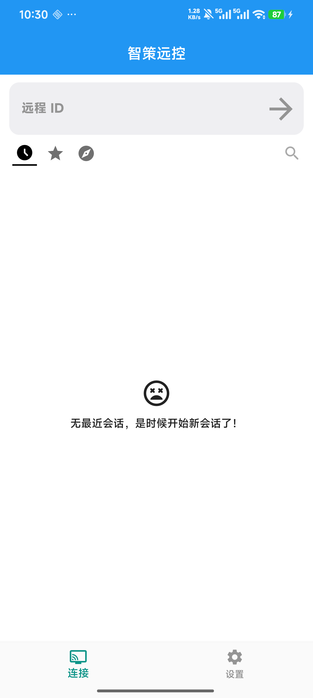

# 智策远控 · zcdesk

> 开源远程桌面，开箱即连。基于 [RustDesk](https://github.com/rustdesk/rustdesk) 二次开发。

**作者**：张翀 · **团队**：智策AI研发团队 · **官网**：[zcdesk.jiuyeke.cn](https://zcdesk.jiuyeke.cn)

## 这是什么

在 RustDesk 1.5.1 基础上定制的自托管远程控制客户端，专为企业/团队私有化部署优化：

- **零配置接入**：默认连接自建服务器（ID/中继/Key 编译时内置），安装即可用
- **全新品牌**：智策远控中文名 + ZC logo + teal 配色，界面无 RustDesk 残留
- **完整上游能力**：跨平台（Windows/macOS/Linux/Android）、P2P 直连优先、自动降级中继

## ⚠️ 重要：Android 版是「单向」客户端

> **Android 版（APK）只能用它去控制别人，不能被别人控制。**
> 这是设计如此，不是功能缺失。

| 端 | 连接方向 | 说明 |
|---|---|---|
| **Android（APK）** | **单向：只出不进** | 只能主动控制电脑/其他设备；**本机不启动被控服务，任何人无法远程连接这台手机**；界面不显示本机 ID 与密码 |
| Windows / Linux / macOS | 双向 | 既能控制别人，也能被别人控制（远程办公/技术支持场景需要） |

**为什么 Android 设成单向？**

1. **安全**：手机是最私密的设备（相册、微信、银行），永不留远程后门
2. **减少杀软误报**：远程控制类 App 被安全软件标记，主要因为它具备"被控能力"（录屏 + 注入触摸 + 后台常驻）。单向模式从设计上就排除这种可能
3. **使用场景明确**：手机上更多是用它去操作电脑，而不是被电脑控

技术实现：Android 端硬编码 `conn-type=outgoing`（RustDesk 官方支持的连接模式），在 `src/common.rs` 的 `zc_seed_default_server()` 中通过 `cfg(target_os = "android")` 条件注入，不影响桌面端。

## 软件预览

### Windows 桌面端


> 主界面即开即用：品牌 Logo、自动分配 ID、自动连接自建服务器（左下角「就绪」）、teal 配色主题。首次启动自动写入服务器配置，无需任何手工设置。

### Android 手机端（单向控制版）



> 手机实机截图（小米 14 / vivo 类设备实装）：界面只有「远程 ID」输入框——**没有本机 ID/密码区**，单向模式生效。应用名 智策远控，ZC teal 图标。

## 与上游的差异

| 改动 | 位置 |
|---|---|
| 品牌名 `智策远控`（UI 文本自动替换） | `src/common.rs` `zc_seed_default_server()` |
| 默认服务器三件套（ID/中继/Key，仅空时填充） | 同上 |
| teal 配色主题 | `flutter/lib/common.dart` |
| ZC logo（exe/托盘/应用内） | `res/`、`flutter/windows/runner/resources/`、`flutter/assets/` |
| **Android 单向模式**（只能控人，不能被人控） | `src/common.rs` `zc_seed_default_server()` 中 `#[cfg(target_os = "android")] conn-type=outgoing` |
| Android 应用名/图标/自适应底色 | `flutter/android/app/src/main/AndroidManifest.xml`、`res/mipmap-*`、`res/values/` |
| 云打包工作流 `zcdesk-*` 产物命名 | `.github/workflows/` |

## 构建

```bash
# Actions 云构建（推荐）
gh workflow run zc-build.yml --ref zc-custom -f upload-tag=v1.0
# 产物在各平台 Release
```

## 服务器部署

配套自建服务端与部署文档见私有运维仓库（内部），服务端使用官方 [rustdesk-server](https://github.com/rustdesk/rustdesk-server)（hbbs + hbbr）。

## 源码与许可

**本仓库包含完整上游官方源码**（基线快照：rustdesk/rustdesk@3513c97，RustDesk 1.5.1）以及智策远控的全部修改——任何构建产物对应的完整源码均以本仓库为准。

遵循上游 **AGPL-3.0** 许可证。修改与再分发请保留许可声明与上游署名。

---
Powered by RustDesk · Rebuilt by 智策AI研发团队
