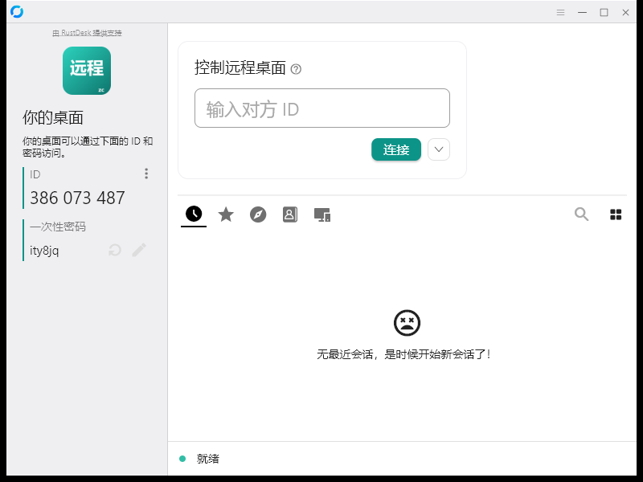

# 智策远控 · zcdesk

> 开源远程桌面，开箱即连。基于 [RustDesk](https://github.com/rustdesk/rustdesk) 二次开发。

**作者**：张翀 · **团队**：智策AI研发团队 · **官网**：[zcdesk.jiuyeke.cn](https://zcdesk.jiuyeke.cn)

## 这是什么

在 RustDesk 1.5.1 基础上定制的自托管远程控制客户端，专为企业/团队私有化部署优化：

- **零配置接入**：默认连接自建服务器（ID/中继/Key 编译时内置），安装即可用
- **全新品牌**：智策远控中文名 + ZC logo + teal 配色，界面无 RustDesk 残留
- **完整上游能力**：跨平台（Windows/macOS/Linux/Android）、P2P 直连优先、自动降级中继

## 软件预览



> 主界面即开即用：品牌 Logo、自动分配 ID、自动连接自建服务器（左下角「就绪」）、teal 配色主题。首次启动自动写入服务器配置，无需任何手工设置。

## 与上游的差异

| 改动 | 位置 |
|---|---|
| 品牌名 `智策远控`（UI 文本自动替换） | `src/common.rs` `zc_seed_default_server()` |
| 默认服务器三件套（ID/中继/Key，仅空时填充） | 同上 |
| teal 配色主题 | `flutter/lib/common.dart` |
| ZC logo（exe/托盘/应用内） | `res/`、`flutter/windows/runner/resources/`、`flutter/assets/` |
| 云打包工作流 `zcdesk-*` 产物命名 | `.github/workflows/` |

## 构建

```bash
# Actions 云构建（推荐）
gh workflow run zc-build.yml --ref zc-custom -f upload-tag=v1.0
# 产物在各平台 Release
```

## 服务器部署

配套自建服务端与部署文档见私有运维仓库（内部），服务端使用官方 [rustdesk-server](https://github.com/rustdesk/rustdesk-server)（hbbs + hbbr）。

## 源码与许可

**本仓库包含完整上游官方源码**（基线快照：rustdesk/rustdesk@3513c97，RustDesk 1.5.1）以及智策远控的全部修改——任何构建产物对应的完整源码均以本仓库为准。

遵循上游 **AGPL-3.0** 许可证。修改与再分发请保留许可声明与上游署名。

---
Powered by RustDesk · Rebuilt by 智策AI研发团队
